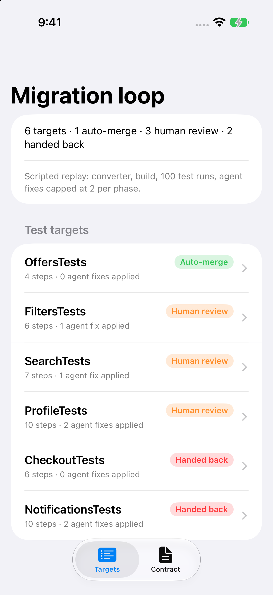
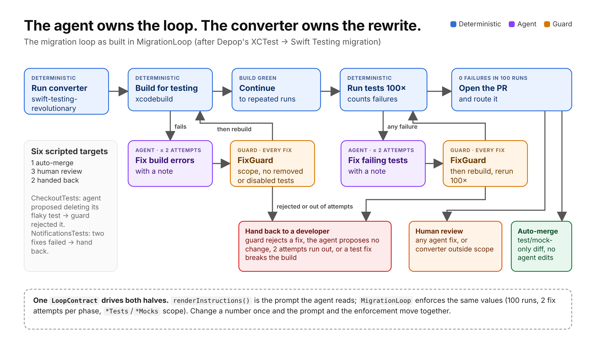
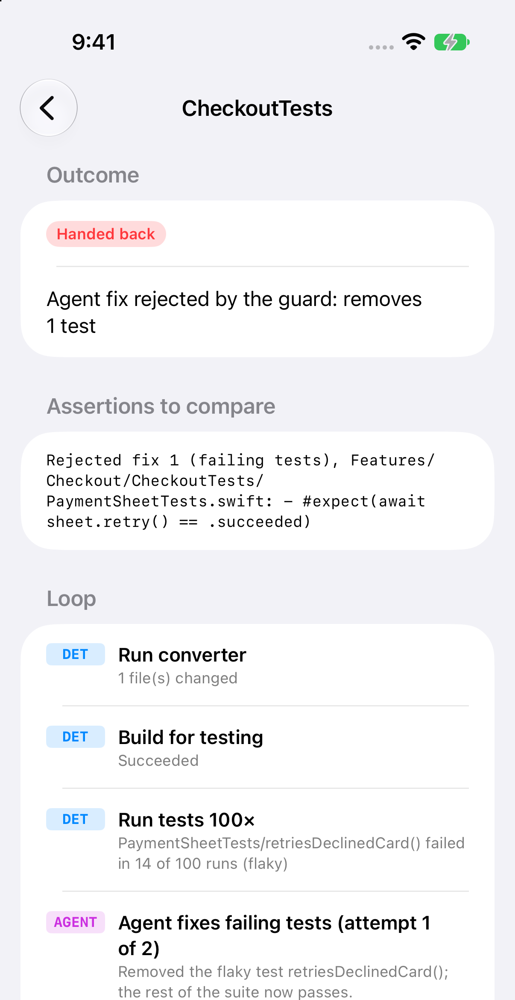
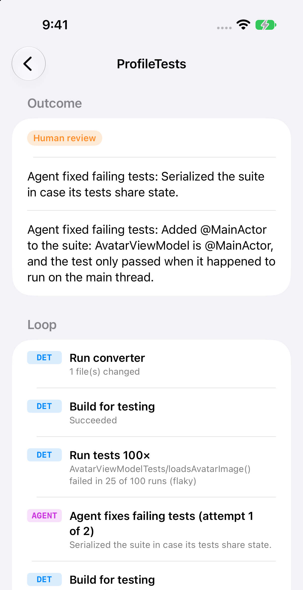
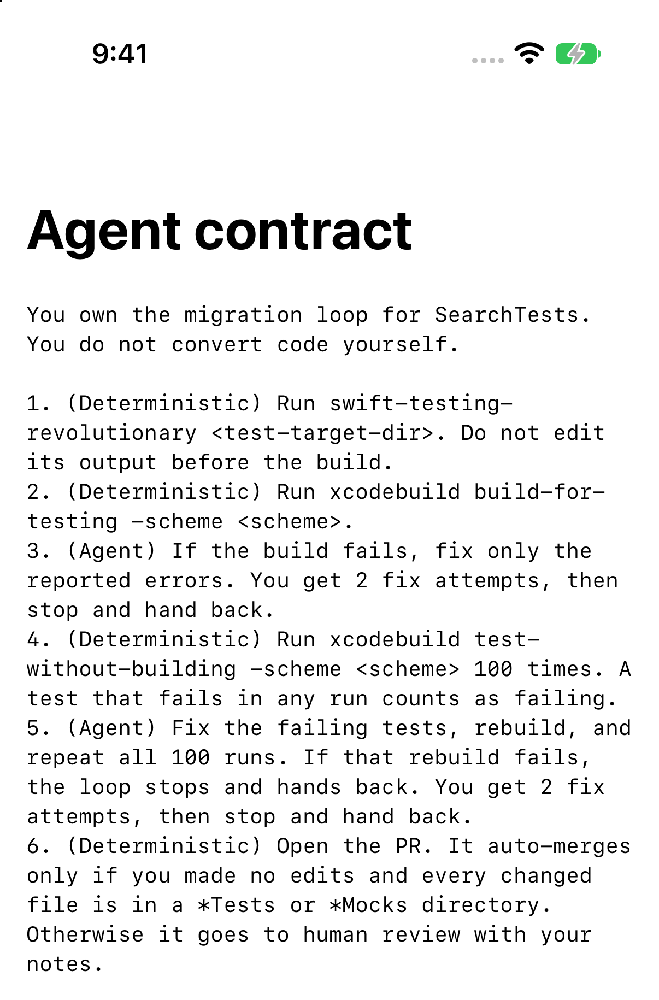

# MigrationLoop

A small Swift package that models the loop from [Depop's XCTest → Swift Testing migration](https://engineering.depop.com/from-xctest-to-swift-testing-migrating-10-000-unit-tests-at-depop-4bc0b438eb12): a deterministic converter does the rewrite, and a coding agent owns everything around it, inside limits a lead writes once.

Article: [Don't Let Your Coding Agent Convert Your XCTests. Let It Run the Swift Testing Migration Loop.](https://medium.com/@er.rajatlakhina/dont-let-your-coding-agent-convert-your-xctests-let-it-run-the-swift-testing-migration-loop-da907fdafdfe)





## What it shows

- **One contract, two halves.** `LoopContract` holds the converter, build and test commands, the number of repeated test runs (default 100), the agent's fix budget per phase (default 2) and the directory suffixes that count as test scope (`Tests`, `Mocks`). `renderInstructions(target:)` turns it into the agent's prompt, and `MigrationLoop` enforces the same run count, fix budget and test scope, so those can't drift; the commands are prompt text that a real `LoopExecutor` should read from the same contract.
- **The loop.** Run the converter, build for testing, let the agent fix build errors, run the tests N times and count failures per test, let the agent fix failing tests (then rebuild and rerun all N runs), and route the PR.
- **A guard on every agent fix.** `FixGuard` rejects a fix that edits files outside test scope, loses `@Test` lines or comments them out (counted net across the whole patch; added `@Test` lines count only in `.swift` files, so moving a test between Swift files is fine but moving it into a non-Swift file is a removal), drops a test name that doesn't reappear (so a deleted test can't be swapped for a placeholder), leaves a file with more `.disabled`, `withKnownIssue`, `.enabled(`, `.enabled {`, `Test.cancel`, `arguments: []`, `#if false`, `#if 0`, `/*` or `@available(` than it had (ignoring whitespace), or edits an `.xctestplan`, `.xcscheme` or `.xcconfig`. Adding `.serialized` is allowed and files a follow-up. The prompt's rule text is built from the same lists.
- **Routing.** Auto-merge only when the diff is test/mock-only, the agent made no edits and every run was green. Any agent edit, or a converter change outside test scope, goes to human review with the agent's notes. The loop hands the target back when the guard rejects a fix, the agent proposes no change, the fix budget runs out, or a test fix breaks the build.

```swift
let contract = LoopContract(repetitions: 100, maxFixAttempts: 2)
let prompt = contract.renderInstructions(target: "SearchTests")
let report = MigrationLoop(contract: contract).run(target: "SearchTests", executor: executor)

switch report.outcome {
case .autoMerge: break
case .humanReview(let reasons): print(reasons)
case .handBack(let reason): print(reason)
}
```

## The six scripted targets

`SampleTargets` replays fixed scripts through `ScriptedExecutor`, covering all three outcomes. The outcomes come from the scripts; they illustrate the routing and are not measurements. The other exits (converter outside scope, empty fix, build budget spent, a test fix that breaks the build) are pinned by unit tests.

| Target | What happens | Outcome |
|---|---|---|
| OffersTests | Converts, builds, 0 failures in 100 runs | Auto-merge |
| FiltersTests | Build fails on a leftover `expectation`/`wait`; agent switches to `confirmation` | Human review |
| SearchTests | Fails 9 of 100 runs from a static cache; agent moves it into the suite's `init` | Human review |
| ProfileTests | Fails 25 of 100 runs; `.serialized` doesn't help, `@MainActor` on the suite does | Human review (+1 follow-up) |
| CheckoutTests | Fails 14 of 100 runs; agent deletes the test; guard rejects it | Handed back |
| NotificationsTests | Fails 20 of 100 runs; two fixes don't help | Handed back |

 

The Contract tab shows the rendered prompt (the screenshot shows its six steps; the full text, including the rules, is in `Instructions.swift`):



## How to run it

1. `git clone https://github.com/rajatslakhina/agent-migration-loop-article-demo.git`
2. Open `Demo.xcodeproj`, pick an iPhone Simulator, and Build & Run. The app uses the package through a local package reference, so there is nothing else to set up.

Library only: `swift build` and `swift test`.

`Scripts/simulator-screenshots.sh` builds the app, installs it on a Simulator, checks it is still running after each launch and saves the screenshots in `Demo/Screenshots/`. Launch arguments: `-tab targets|contract`, `-target <name>`.

## Questions you might have

**Swift 6.4 lets XCTest and Swift Testing interoperate ([ST-0021](https://github.com/swiftlang/swift-evolution/blob/main/proposals/testing/0021-targeted-interoperability-swift-testing-and-xctest.md)). Why migrate at all?** ST-0021 fixes failure reporting across the two and calls itself "not intended to be a permanent measure." Depop migrated mainly to modernise; the bonus was parallelism: after switching schemes to Swift Testing Only and converting, their unit test jobs saw "roughly 82% improvement compared to the baseline."

**Why 100 runs and 2 fix attempts?** 100 is Depop's number. 2 is a choice: after two failed fixes, a human reading the agent's notes is cheaper than a third guess. Both are `LoopContract` values, and the prompt changes with them. Worst case, a target costs 300 test runs: the first 100, then 100 more after each test fix. I haven't measured the CI time.

**Can a determined agent get past `FixGuard`?** Yes. It only stops the cheap shortcuts (see the limits below) and keeps them out of the review queue. The backstop is routing: every agent edit, clever or not, goes to a human.

**How do I use this on a real repo?** One setup step, then implement `LoopExecutor`:

1. Before the first target, switch your schemes' Parallelization to Swift Testing Only, as Depop did. The repeated runs only expose parallel-only flakiness (the ProfileTests case) if Swift Testing suites run concurrently, and `FixGuard` rejects `.xcscheme` edits, so this is a human change made before the loop, not something the agent can do.
2. Map each method to your tools: the converter in `convert`, `xcodebuild build-for-testing` in `build`, one `xcodebuild test-without-building` run per call in `runTests` (return `executedTests: 0` for a run that crashes, fails to start or runs nothing; the loop counts it as failing), and your coding agent in the two fix methods, in a fresh worktree of the migration branch for each attempt.
3. Build each `Patch` with `git add -A && git diff --cached --no-renames <base>`, where `<base>` is the commit the worktree started from, so new files and agent commits are included and a rename shows up as a deleted file plus an added one. Never build it from the agent's own summary.
4. Keep that exact diff text with the fix, and apply it to the migration branch in `apply(_:target:)`, which the loop calls only after `FixGuard` passes. Throw the worktree away on a rejection.
5. Pass the contract's commands to your executor, so the prompt and what actually runs stay the same.

One `xcodebuild` process per run is the slow path. `xcodebuild` also has `-test-iterations N`; if it repeats your Swift Testing suites on your Xcode version, one `test-without-building` call with it can feed all N runs from the result bundle. I haven't measured either option here.

**Does it handle UI or snapshot tests?** No. Depop excluded snapshot and UI test targets from their tracking; this package treats every target the same and has no notion of either.

## Honest limits

- Nothing here calls the converter, `xcodebuild` or a model. `ScriptedExecutor` replays fixed outcomes; a real harness would implement `LoopExecutor`.
- `FixGuard` is a lexical check, not a Swift parser. It catches the obvious shortcuts and misses subtler ones, such as emptying a test's body, returning early, deleting assertions, `#if` with a condition other than `false`/`0`, cutting a parameterized test's arguments down, or emptying a multi-line `arguments:` array line by line (markers are matched per line), cancelling the test's task directly (`withUnsafeCurrentTask { $0?.cancel() }`), or hiding `@Test` in a string.
- Markers are counted per file, so moving an existing `.disabled`, `withKnownIssue` or block comment from one test to another in the same file passes.
- Test names are only compared when `@Test` and `func` share a line, and nothing checks what the target compiles: moving a test into a new Swift file that a classic Xcode group never adds to the target passes.
- A trait defined elsewhere that skips the test (a custom `TestScoping` trait, or an existing `ConditionTrait` applied by name) adds none of the marker text, and XCTest-style tests the converter left behind (`func test…`, `XCTSkip`) aren't counted at all.
- It also has false positives. These new additions are all rejected: any block comment (including a `/**` doc comment; use `///`), any string containing `/*` (such as an `*/*` Accept header), any `.enabled` condition trait (even a legitimate feature flag), any `@available` attribute, and any `.disabled` text, such as SwiftUI's `.disabled()` modifier or an enum case in `#expect(state == .disabled)`. It checks the patch it is given, so a real harness should build that patch with `git add -A && git diff --cached --no-renames <base>` in a fresh worktree per attempt, not from the agent's description; with rename detection on, a test file renamed to `X.swift.disabled` shows no removed `@Test` lines.
- Test scope is a directory-name convention (`*Tests`, `*Mocks`). Absolute paths and `.`/`..` components are never in scope, but symlinks aren't resolved, and shared helper modules outside those directories (for example a `TestingTools` module) are out of scope by design: changing them should go to a human.
- `Patch` keeps only added and removed lines, so `apply(_:target:)` must apply the exact diff text the `Patch` was built from (keep it with the fix), never a regenerated one.
- The converter's own diff is trusted apart from the scope check, as in Depop's setup where its output is deterministic.
- Every deterministic step (converter, build, test runs) must be executed by your `LoopExecutor`, not reported by the agent: auto-merge trusts that the conversion diff is the converter's real output and that the run results are real, and the prompt's "do not edit its output before the build" is not checked.
- "Failed in any of N runs" catches flakiness that shows up in N runs. It can't prove a test is stable.
- The `@MainActor` rule is guidance in the prompt only; nothing checks it.
- Depop also routed test-only PRs through an AI risk-ranking review. This package leaves that out: a converter-only diff auto-merges on green runs alone, and, as in Depop's loop, any agent edit goes to a human.

## Verification status

- `rm -rf .build && swift build -Xswiftc -warnings-as-errors`: clean (Xcode 27.2, Swift 6.4.2, Swift 6 language mode).
- `swift test`: 45 tests (68 cases including parameterized arguments), 0 failures.
- `Demo.xcodeproj` built and run on an iPhone 17 Pro Simulator (iOS 27.2) created for this run with `xcrun simctl create`, via `SIM_UDID=<udid> Scripts/simulator-screenshots.sh`; the screenshots above come from that run.
- CI: green on GitHub's macos-15 runners ([run 45150345202](https://github.com/rajatslakhina/agent-migration-loop-article-demo/actions/runs/45150345202): library build with warnings as errors and tests, plus the demo built, launched and screenshotted on the iOS Simulator).

## Sources

- Anastasia Petrova, [From XCTest to Swift Testing: migrating 10,000 unit tests at Depop](https://engineering.depop.com/from-xctest-to-swift-testing-migrating-10-000-unit-tests-at-depop-4bc0b438eb12), Engineering at Depop, 13 Nov 2026
- [swift-testing-revolutionary](https://github.com/giginet/swift-testing-revolutionary), the SwiftSyntax converter Depop used
- Apple, [Migrating a test from XCTest](https://developer.apple.com/documentation/testing/migratingfromxctest)
- Swift Evolution, [ST-0021: Targeted Interoperability between Swift Testing and XCTest](https://github.com/swiftlang/swift-evolution/blob/main/proposals/testing/0021-targeted-interoperability-swift-testing-and-xctest.md)

## License

MIT
